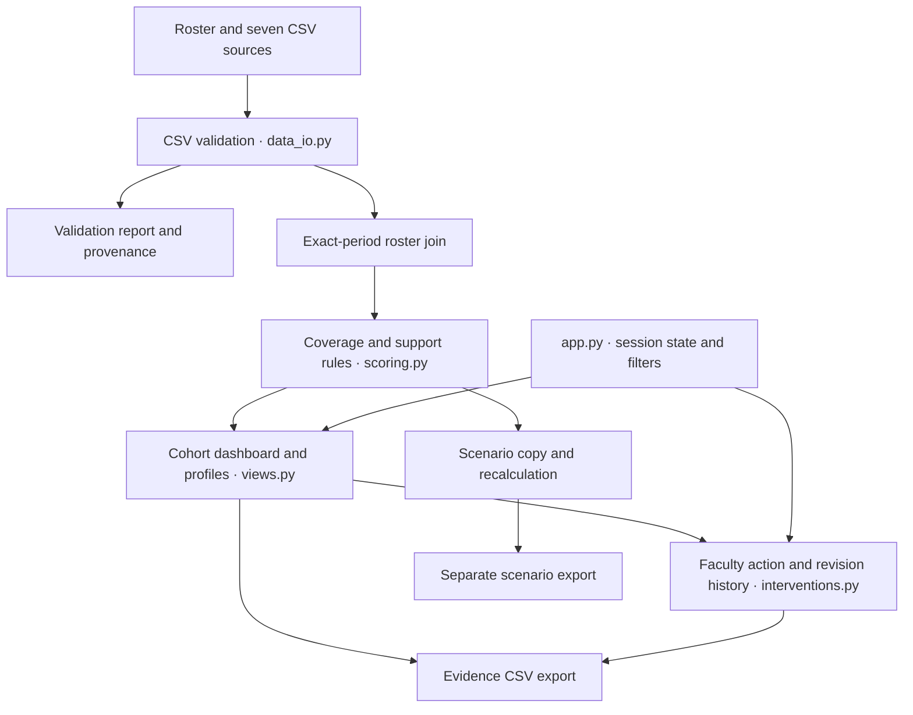
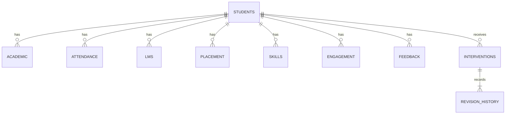

# PULSEIQ architecture and implementation stages

PULSEIQ is a single Python application for institutional staff, following the attached Campus Compass PRD. A college data team supplies records, faculty inspect support evidence, and placement coordinators plan training. Student self-service is a later release.

## Implemented system

All execution is server-side Python except the browser-rendered Streamlit widgets and Plotly charts. There is no separate REST API, database, worker service or model server in this release. Dataset and intervention state lives in one browser session's `st.session_state`. No user data is globally cached. Charts and exports use the same filtered scored dataframe; the import-quality screen intentionally describes the entire active dataset or last attempted import.

The bundled assets are immutable demonstration inputs. The separate UCI study is an academic-only benchmark, never a substitute for missing evidence categories.

## Data path

1. **Parse:** read UTF-8 CSV bytes with identifiers as text; enforce 5 MiB and 1,000 rows per file.
2. **Validate:** check schema, blank IDs, duplicate keys, numeric bounds, integral counts, dates and numerator/denominator consistency. Report filename and CSV row number.
3. **Activate transactionally:** any blocking error prevents batch activation. The old dataset remains active. Unmatched IDs are warnings and excluded until resolved; blank measurements and zero denominators remain missing.
4. **Select period:** choose exactly one reporting date across sources. Records from other dates are not silently used.
5. **Join:** roster left joins with `validate='one_to_one'` ensure exactly one joined row per roster student. Retain filenames, import timestamps, source dates and presence/freshness markers.
6. **Determine freshness:** reporting period age relative to the visible analysis date. Age <0 or age beyond the configured window means evidence is excluded from current scoring.
7. **Compute components and coverage:** require all placement and skills constituents; preserve missing components. Apply complete, provisional or insufficient score state.
8. **Determine support:** evaluate fresh observed fields only. Preserve known triggers and mark incomplete negative findings Undetermined. Build overlapping segments and grounded support playbooks.
9. **Review:** show source evidence and allow editable faculty actions. All revisions append a snapshot event, including reopening a reviewed/closed action.
10. **Export:** emit filtered evidence, action, history or separate scenario CSVs. Prefix formula-like user-entered strings to prevent spreadsheet formula execution.

## Module interfaces

| Module | Input | Output |
| --- | --- | --- |
| `data_io.import_files(files)` | `{source: (filename, bytes)}` | `ImportResult(tables, report, summary)` and `.ok`, `.periods` |
| `data_io.integrate(result, period, analysis_date, stale_days)` | Accepted import and selected date policy | One dataframe row per roster student with raw fields and provenance |
| `scoring.score_dataset(frame)` | Integrated dataframe | Scored dataframe with A/T/L/P/S/E, coverage, score state, separate flags, reasons, segments and recommendations |
| `scoring.component_breakdown(record)` | One scored dict | Component values, weights, original/effective points and provenance |
| `scoring.simulate(record, changes)` | Baseline dict and permitted changes | Independent recalculated dict; baseline is never mutated |
| `interventions.create_action(...)` | Session lists and validated action fields | New action list and appended history list |
| `interventions.update_action(...)` | Session lists, ID and edited fields | Revised action list and appended snapshot history |
| `views.*` | Filtered scored dataframe or activation callback | Streamlit UI; session actions updated only through workflow functions |
| `app.py` | Browser widgets and session state | Active dataset, selected period, filters, navigation and module wiring |

An import or benchmark activation is queued for the next Streamlit rerun so widget state resets occur before widgets are instantiated. Switching datasets clears actions/history to avoid linking old actions to unrelated student IDs. Changing a reporting period preserves existing actions because their student IDs still belong to the same roster.

## Entity relationships

Each evidence source has the unique key `(student_id, period_end)`. Interventions have an independent ID, owner, action, rationale, due date and review status. Session history preserves every revision rather than overwriting earlier notes.

## Delivery stages and dependencies

| Stage | Owner | Starts after | Completion gate |
| --- | --- | --- | --- |
| 1. Scaffold | Member 1 | Repository exists | App starts locally, dependency pins and common interfaces agreed |
| 2. Data | Member 2 | Schemas agreed | Eight CSVs and validator pass valid/invalid fixtures |
| 3. Decision engine | Member 3 | Schemas agreed; uses fixtures before full dataset | 68.0 reference, coverage, missingness and separate flags pass tests |
| 4. Screens | Member 4 | Data/scoring contracts agreed | Filters, charts, profiles and source evidence render |
| 5. Workflow | Member 5 | Student ID and recommendation contracts agreed | Create, edit, review, reopen and exports pass |
| 6. Integrate | Member 1 plus all | Modules available | All local integration tests and browser workflow pass |
| 7. Deploy/demo | Whole team | Source pushed to GitHub | Fresh HTTPS browser completes import/profile/action/download workflow |

Stages 2–5 can proceed in parallel after schema agreement. Members 4 and 5 use fixtures until Members 2 and 3 provide finished outputs. This package already supplies all implemented modules; the next team task is to run it, review it and make scoped changes on feature branches.

## Future institutional architecture

For production, add an authenticated identity provider, backend authorization by institution/department, encrypted database storage for records and audit events, approved import/connectors and retention/correction workflows. Add outcome prediction only after defining a dated target and historical evaluation plan. Those services and a student portal are not implemented here.
